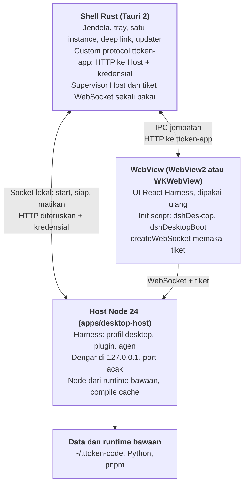

# PRD: TTOken Code Desktop di Tauri (shell Rust)

Nov 21, 2026 · @naufal

TTOken Code Desktop pindah dari Electron ke Tauri 2: proses utamanya menjadi biner Rust, sedangkan UI React dan Host TypeScript tetap, dengan Host berjalan di Node bawaan. Fase 0 mengukur RAM dan waktu start di Windows 11 lebih dulu; kalau hasilnya tidak lolos gerbang, port penuh tidak dimulai.

## Kondisi sekarang

Per 21 Nov 2026 (branch `ttoken/desktop-shell` di `370e2508c`), TTOken Code Desktop adalah shell Electron yang membungkus seluruh Harness. Semua angka di bawah dibaca dari repo dan run CI terakhir.

| Bagian | Sekarang |
| --- | --- |
| Shell | Electron 44.7 dan electron-builder 26.17 di `apps/desktop`: ±11.700 baris TypeScript main process (`src/`), ±12.000 baris skrip build, packaging, dan uji, ±1.000 baris renderer sambutan dan dialog |
| Host | `apps/desktop-host` jalan sebagai proses anak Electron dalam mode Node (`ELECTRON_RUN_AS_NODE`, `--expose-internals`), lewat Node IPC: `starting`, `desktop-auth`, `ready`, `shutdown`, `shutdown-complete`, `file-drag-*`, `quit-inspection`, `plugin-operation` |
| Halaman dan transport | Web client dimuat dari `dsh-app://app/`. Main process meneruskan HTTP ke Host dengan kredensial. WebSocket langsung ke `127.0.0.1:<port>`, kredensialnya ditempel Electron. Port Host dipilih OS tiap start |
| Jembatan ke UI | 34 kanal `DESKTOP_IPC` dan 10 global preload: `dshDesktop` (protocolVersion 1), `dshDesktopBoot`, `dshOnboarding`, `dshWelcome`, `dshUpdateDialog`, `dshMandatoryUpdate`, `dsh`, `__DSH_DIRECTORY_PICKER__`, `__DSH_HOST_PATHS__`, `__DSH_LOCALE__`. Client memeriksa tiap global; bila tidak ada, client memakai perilaku Web |
| Kode Harness | ±648.000 baris kode non-test (TypeScript dan CSS) di `packages/`, ±225.000 di antaranya UI client. Tidak disentuh proyek ini |
| Runtime bawaan | Python 3.12.14 (numpy, pandas, Pillow, lxml, dan lain-lain), Node 24.21.0 di `primary-runtime/dependencies/node/bin/`, dan pnpm |
| Addon native | node-pty 1.2.0-beta.15, sharp 0.35.5, `@deepseek-ai/node-addon-system`; `@vscode/ripgrep` berupa biner |
| Installer Windows | ±325 MB, tanpa tanda tangan, kompresi level 1 (artifact `ttoken-code-windows-x64-unsigned`) |
| Lapisan TTOken di shell | appId `dev.ttoken.code`, skema `ttoken-code://`, data `~/.ttoken-code`; sambutan meminta API key Gateway (`accountLogin` mati); installer NSIS kustom (logo terisi air, menutup app lewat `--quit-for-installer`); warna awal bilah judul Windows |
| Dimatikan di TTOken | Platform view DeepSeek, menu "Manage dsh Command", analitik |
| Update | Build tanpa tanda tangan tidak punya auto-update; layanan kebijakan dan feed milik TTOken belum ada |
| macOS | Job CI hanya jalan manual; belum ada Mac untuk menguji |

## Tujuan dan target

Tiga tujuan dari Naufal menentukan proyek ini: RAM lebih hemat, app terasa lebih cepat, dan shell yang benar-benar Rust. Paritas fitur adalah syarat rilis, bukan tujuan.

| Tujuan | Ukuran | Gerbang Fase 0 (K1) | Target rilis |
| --- | --- | --- | --- |
| RAM hemat | Total private working set semua proses app: shell, WebView, dan Host Node | Lebih rendah dari Electron di S1 sampai S3 | Sama, diukur ulang di build rilis |
| App lebih cepat | (a) klik ikon sampai jendela tampil; (b) sampai composer bisa diketik; (c) waktu ganti sesi | (a), (b), dan (c) lebih cepat dari Electron | (b) lebih cepat dari Electron; angka pastinya ditetapkan dari hasil Fase 0 |
| Built with Rust | Proses utama app adalah biner Rust; installer tidak memuat Electron | Prototipe jalan tanpa Electron | Klaim yang boleh: "shell native Rust (Tauri)". Yang tidak boleh: "ditulis penuh dalam Rust", karena Host dan UI tetap TypeScript |
| Paritas | Tiap baris `PARITY.md` berstatus selesai atau sengaja dibuang | Daftar awal ada | Semua baris yang dipakai TTOken selesai |

Cara mengukur, dipakai di Fase 0 dan Fase 5:

1. Mesin Windows 11 yang sama untuk kedua build, tanpa app berat lain. macOS dicatat terpisah bila ada.
2. Skenario: S1 idle 2 menit setelah composer siap di workspace kecil; S2 membuka satu sesi panjang lalu menggulir sampai bawah; S3 panel Device dan tab Issues terbuka, lalu pindah bergantian di antara 3 sesi.
3. Memori: jumlah private working set seluruh pohon proses app, termasuk `msedgewebview2.exe` dan `node.exe`, beserta angka per proses.
4. Waktu (a), (b), dan (c) dari log bertanda waktu yang ditulis shell dan Host.
5. Lima kali per skenario, dilaporkan median. Start dingin setelah reboot dicatat terpisah.

Bukan tujuan:

- Menulis ulang Host atau UI ke Rust.
- Mengecilkan installer: ukurannya dicatat, tetapi bukan target.
- Linux, Platform view DeepSeek, menu dsh command, dan layanan kebijakan update wajib.

## Arsitektur

**Hanya shell yang berganti ke Rust; UI dan Host tetap TypeScript.** Kotak berwarna: kode baru (Rust). Kotak lain: kode yang sudah ada.



Rust hanya menggantikan proses induk: halaman bicara ke shell lewat jembatan dan protocol `ttoken-app`, shell mengatur Host lewat socket lokal, dan WebSocket langsung ke Host dengan tiket sekali pakai.

## Keputusan teknis

Host dan UI tetap seperti sekarang; yang berubah hanya proses induknya, cara halaman dimuat, dan cara kredensial sampai ke Host.

| # | Keputusan | Alasan |
| --- | --- | --- |
| D1 | [Tauri 2.12.x](https://v2.tauri.app/release/tauri/) (terbaru 2.12.7, 18 Nov 2026) dan Rust stable. Kode baru di `ttoken/desktop-tauri/` | Folder milik TTOken: merge dari upstream tidak bentrok, dan `apps/desktop` upstream tetap utuh selama transisi |
| D2 | Host = bundel `apps/desktop-host` yang ada, dijalankan Node 24.21.0 dari runtime bawaan dengan flag yang sama (`--expose-internals`) | Host dan UI tidak ditulis ulang; Node itu sudah ada di installer |
| D3 | Kanal shell dan Host: socket lokal (Unix socket di macOS, named pipe di Windows, hanya untuk user yang sama), satu pesan JSON per baris, tipe pesan sama dengan Node IPC sekarang. Shim kecil di desktop-host lewat aturan patcher | Node IPC butuh proses induk Node. Isi pesan tetap supaya logika Host tidak berubah |
| D4 | Asal halaman tetap lewat custom protocol `ttoken-app` (di Windows `http://ttoken-app.localhost/`). Rust meneruskan HTTP dari asal itu ke Host dan menambahkan kredensial | Port Host acak tiap start, padahal localStorage dan IndexedDB terikat ke asal. Asal yang tetap menjaga data halaman antar-start |
| D5 | WebSocket memakai tiket sekali pakai dari shell, lewat hook `__DSH_TRANSPORT__.createWebSocket` yang sudah ada di `@deepseek-ai/dsh-client-connection`. Host menerima tiket dan asal `ttoken-app` lewat aturan patcher; `apps/web/src/main.ts` dipatch supaya tidak menimpa hook itu | Tauri tidak punya padanan `webRequest` Electron untuk menempel kredensial ke handshake WebSocket (diverifikasi di Fase 0). Kredensial jangka panjang tetap di luar JS halaman |
| D6 | Jembatan: nama global dan API sama, dibuat init script hanya di frame utama, didukung command Tauri. [Capability](https://v2.tauri.app/reference/acl/capability/) hanya untuk jendela utama dan sambutan, tanpa `remote` | Client tidak perlu diubah. Iframe pratinjau dan browser samping tidak boleh melihat jembatan |
| D7 | Browser samping memakai fallback Web (iframe) dulu; child webview diputuskan di Fase 3 (K3) | Beberapa webview dalam satu jendela masih [API `unstable`](https://v2.tauri.app/reference/javascript/api/namespacewebview) di Tauri |
| D8 | Update lewat [`tauri-plugin-updater`](https://v2.tauri.app/plugin/updater/) dengan kunci tanda tangan dan feed TTOken, di Fase 4 | Tanda tangan update wajib dan tidak bisa dimatikan; build sekarang belum punya feed |
| D9 | Installer: bundler NSIS Tauri dengan `installerHooks` atau template kustom untuk halaman TTOken; WebView2 `embedBootstrapper` dengan `minimumWebview2Version`; per-user seperti installer Electron sekarang | [WebView2 sudah dibawa](https://v2.tauri.app/distribute/windows-installer/) Windows 10 (April 2018 ke atas) dan 11. Tampilan installer TTOken dipertahankan |
| D10 | Identitas tetap: appId `dev.ttoken.code`, data `~/.ttoken-code`, profil `desktop`. Installer Tauri menggantikan instalasi Electron | User tidak kehilangan sesi, API key, dan pengaturan |
| D11 | Plugin resmi Tauri: single-instance, deep-link (`ttoken-code://`), dialog, clipboard-manager, opener, window-state, log | Pengganti modul Electron yang setara, dirawat tim Tauri |
| D12 | Host diberi [compile cache Node](https://nodejs.org/download/release/v22.23.0/docs/api/module.html) (`NODE_COMPILE_CACHE` di folder cache app, `module.flushCompileCache()` setelah Host siap). Dipakai bila Fase 0 menunjukkan start lebih cepat tanpa error | V8 code cache di disk mempercepat muat modul pada start berikutnya tanpa mengubah kode Host. Cache hanya ditulis saat proses keluar kecuali di-flush |
| D13 | macOS sekunder: dibangun dan di-smoke-test di CI sejak Fase 0, dirilis setelah dicoba di Mac (K6) | WKWebView bukan Chromium, dan belum ada Mac untuk uji |

## Peta paritas

Tiap modul main process Electron (`apps/desktop/src/`) diport, ditunda, atau dibuang; tabel ini daftar awal untuk `ttoken/desktop-tauri/PARITY.md`, yang dicek CI terhadap kunci `DESKTOP_IPC` dan global preload upstream.

| Area | File Electron | Rencana Tauri | Fase |
| --- | --- | --- | --- |
| Siklus app dan jendela | `main.ts`, `single-instance.ts`, `quit-confirmation.ts`, `background-notice.ts`, `tray.ts`, `windows-layout.ts`, `preload-windows.ts`, `preload-theme.ts`, `preload-platform.ts`, `preload-menu.ts` | Jendela, tray, tutup ke latar, satu instance, menu app, bilah judul Windows kustom (atribut `data-window-drag` client dipetakan ke drag Tauri) | 1 |
| Host | `host-process.ts`, `backend-controller.ts`, `parent-authentication.ts`, `fatal-recovery.ts`, `startup-error.ts`, `node-environment.ts`, `login-shell-environment.ts`, `owned-directory.ts`, `paths.ts`, `duration-env.ts` | Supervisor Rust: start Node, kanal socket, kredensial, siap, crash ke dialog pemulihan, matikan saat keluar, `--quit-for-installer` | 0 sampai 1 |
| Halaman dan transport | `web-document.ts`, `client-metadata.ts`, `host-protocol.ts`, `ipc.ts` | Custom protocol `ttoken-app` dan tiket WebSocket | 0 |
| Sambutan | `welcome-window.ts`, `welcome-backend.ts`, `welcome-api.ts`, `preload-welcome.ts`, `client/WelcomePage.tsx`, `client/welcome.tsx`, `account-backend.ts` | Halaman React yang sama; `dshWelcome` dan `dshOnboarding` lewat command | 1 |
| Bahasa | `locale.ts`, `locale-cache.ts` | String shell 8 bahasa dibangkitkan dari `locale.ts` saat build, jadi tetap satu sumber | 1 |
| API produk `dshDesktop` | `file-actions.ts`, `file-drag.ts`, `file-drag-files.ts`, `directory-picker.ts`, `device-info.ts`, `keyboard.ts`, `keybindings.ts`, `settings-file.ts`, `settings.ts`, `microphone-permissions.ts`, `preload-app.ts` | Satu command Tauri per method; `keybindings.json` diimpor sekali dari folder data Electron lama | 2 |
| Diagnostik dan operasi paket | `crash-report.ts`, `operation-journal.ts`, `operation-history.ts`, `operation-report.ts`, `operation-report-job.ts`, `operation-report-worker.ts`, `runtime-tree.ts`, `core-package-set.ts`, `project-manager.ts` | Audit di Fase 0: mana yang hidup di shell dan mana di Host; port yang dipakai TTOken | Audit 0, port 2 |
| Browser samping | `browser-guests.ts`, `preload-browser.ts` | Fallback iframe dulu; child webview bila K3 memilihnya | 3 |
| Update | `update-*.ts`, `updates/electron-updater/*`, `preload-update-dialog.ts`, `release.ts` | Diganti `tauri-plugin-updater` | 4 |
| Update wajib | `mandatory-update-*.ts`, `preload-mandatory*.ts`, `policy-test-auth.ts` | Ditunda sampai layanan kebijakan milik TTOken ada | Nanti |
| Dibuang | `platform-view.ts`, `platform-ipc.ts`, `preload-platform-account.ts` (Platform view tidak dipakai TTOken); `command-installation.ts`, `command-management.ts`, `command-manager-entry.ts` (menu dsh command sudah dihapus) | Tidak diport | Tidak ada |

## Fase dan gerbang

Enam fase berurutan; Fase 0 berakhir di gerbang, dan Fase 1 hanya dimulai setelah Naufal menyetujui hasilnya.

### Fase 0: spike dan ukur

Hasilnya angka nyata Electron dan Tauri di Windows 11, plus rekomendasi lanjut atau berhenti.

1. Buat branch kerja (K9).
2. Tulis skrip ukur PowerShell di `ttoken/desktop-tauri/measure/` untuk skenario S1 sampai S3. Keluarannya JSON dan ringkasan Markdown.
3. Ukur baseline dari installer Electron CI terbaru.
4. Bangun prototipe Tauri: jendela utama, Host di Node bawaan lewat kanal socket (D3), custom protocol (D4), tiket WebSocket (D5), dan `dshDesktopBoot` saja. Jembatan lain belum ada, jadi client memakai perilaku Web. Sambutan dilewati dengan API key dari profil yang sudah ada.
5. Pastikan addon native jalan di Node biasa: node-pty membuka terminal, sharp memproses gambar, `node-addon-system` termuat, ripgrep mencari, dan peluncur node untuk skrip paket (sekarang meneruskan ke Electron) memakai Node bawaan.
6. Ukur prototipe dengan skrip yang sama, dengan dan tanpa compile cache (D12).
7. Tambah job CI macOS: prototipe terbuka dan composer tampil di WKWebView, dengan screenshot.
8. Audit modul berlabel audit di peta paritas, lalu tulis `ttoken/desktop-tauri/PARITY.md` awal.
9. Tulis `ttoken/desktop-tauri/docs/fase-0-hasil.md`, lalu berhenti dan minta keputusan Naufal.

Kriteria penerimaan:

- Tabel median S1 sampai S3 untuk Electron dan Tauri: memori total, memori per proses, dan waktu (a), (b), (c).
- Status tiap addon native di Node biasa.
- Rekomendasi lanjut atau berhenti beserta alasannya, dibandingkan dengan ambang K1.

### Fase 1: shell inti

Hasilnya TTOken Code yang bisa dipakai sehari-hari di Windows tanpa Electron.

1. Supervisor Host lengkap: start, siap, crash ke dialog pemulihan, start ulang, matikan saat keluar, `--quit-for-installer`.
2. Jendela utama dengan bilah judul Windows kustom, dan vibrancy di macOS.
3. Layar sambutan React yang sama, dengan `dshWelcome` dan `dshOnboarding` lewat command.
4. Tray, tutup ke latar, konfirmasi keluar, satu instance, dan deep link `ttoken-code://`.
5. String shell 8 bahasa dibangkitkan dari `apps/desktop/src/locale.ts` saat build.
6. Log berkas di folder data app; DevTools lewat F12 dan Ctrl+Shift+I seperti sekarang.
7. Workflow CI `ttoken-desktop-tauri.yml` yang membangun installer Windows tanpa tanda tangan, artifact `ttoken-code-tauri-windows-x64-unsigned`.

Kriteria penerimaan:

- Instal baru: sambutan, API key, workspace, lalu chat lewat Gateway berjalan.
- Panel Device, tab Issues, dan halaman Plugins (instal dan hapus plugin lewat pnpm bawaan) berjalan.
- Setelah keluar dari tray, tidak tersisa `node.exe` atau `msedgewebview2.exe` milik app.
- Host yang dimatikan paksa memunculkan dialog pemulihan, dan start ulang berhasil.
- Kredensial Host tidak ada di JS halaman, storage, atau log (uji otomatis).
- Iframe tidak melihat jembatan apa pun (uji otomatis).

### Fase 2: paritas desktop

Hasilnya semua API `dshDesktop` yang dipakai TTOken, kecuali `browser` dan `updates`.

1. `fileActions`: dialog simpan dan baca gambar dari clipboard.
2. `fileDrag`: menyeret berkas dari app ke Explorer atau Finder.
3. Pemilih folder lewat `__DSH_DIRECTORY_PICKER__`.
4. `__DSH_HOST_PATHS__`: bila WebView tidak memberi path untuk berkas yang di-drop, tetap pakai perilaku Web dan catat di `PARITY.md`.
5. `keyboard` dan `shortcuts`: `keybindings.json` dan chord yang sekarang dicegat sebelum halaman menerimanya.
6. Izin mikrofon, `deviceInfo`, dan `__DSH_LOCALE__`.
7. Modul diagnostik yang lolos audit Fase 0.

Kriteria penerimaan:

- Semua baris Fase 2 di `PARITY.md` selesai, masing-masing dengan uji.
- Uji E2E alur inti jalan di CI Windows (WebDriver lewat `tauri-driver`, atau alat lain yang dipilih di Fase 0).

### Fase 3: browser samping

1. Putuskan K3 dengan data Fase 2: fallback iframe cukup, atau perlu child webview.
2. Bila child webview: satu data store per workspace, aturan navigasi seperti `browser-guests.ts`, dan routing shortcut ke halaman tamu.

Kriteria penerimaan: bila child webview dipilih, browser samping membuka situs yang menolak iframe (misalnya github.com); bila tidak, keterbatasannya tertulis di `PARITY.md` dan README.

### Fase 4: installer dan update

1. Installer NSIS Tauri dengan halaman TTOken (logo terisi air, menutup app yang berjalan) lewat hooks atau template.
2. WebView2 `embedBootstrapper` dengan `minimumWebview2Version`.
3. Hook pra-instal menghapus instalasi Electron lama secara senyap (entri uninstall installer Electron untuk appId `dev.ttoken.code`) tanpa menyentuh `~/.ttoken-code`.
4. Updater: kunci tanda tangan dibuat setelah Naufal setuju, disimpan di secret CI, dan feed sesuai K4.
5. Jalur tanda tangan Authenticode dan Apple disiapkan, aktif setelah sertifikat ada.
6. DMG macOS tanpa tanda tangan.
7. Perbarui `ttoken/README.md`.

Kriteria penerimaan:

- Upgrade dari installer Electron terakhir mempertahankan sesi, API key, dan shortcut.
- Update dari versi N ke N+1 lewat feed uji berhasil, dan update dengan tanda tangan salah ditolak.
- Installer menangani app yang sedang berjalan seperti installer sekarang.

### Fase 5: pindah penuh

1. Ukur ulang S1 sampai S3 di build rilis.
2. Bila target di bagian Tujuan terpenuhi, Tauri menjadi build utama dan workflow Electron (`ttoken-desktop-unsigned.yml`) dimatikan.
3. Teks marketing memakai klaim yang disetujui.

Kriteria penerimaan: angka rilis tercatat di `ttoken/desktop-tauri/docs/fase-5-hasil.md`, dan tidak ada baris yang dipakai di `PARITY.md` yang belum selesai.

## Risiko

Risiko terbesar adalah RAM yang tidak turun di Windows, karena WebView2 sendiri berbasis Chromium; itu sebabnya ada gerbang di Fase 0.

| Risiko | Dampak | Penanganan |
| --- | --- | --- |
| RAM tidak turun di Windows. Uji di [issue Tauri #5889](https://github.com/tauri-apps/tauri/issues/5889) (era Tauri 1, memori bersama ikut dihitung) memuat web app berat dan mencatat Tauri 370 sampai 399 MB, Electron 312 sampai 318 MB di Windows 10 | Tujuan utama tidak tercapai | Gerbang Fase 0; berhenti sebelum port penuh |
| WKWebView di macOS berbeda dari Chromium; di uji yang sama Tauri juga lebih boros (421 dan 429 MB, Electron 337 dan 332 MB) | Bug tampilan dan RAM lebih tinggi di macOS | Smoke CI, audit fitur web yang dipakai client, rilis macOS setelah uji manual |
| Child webview masih `unstable` | Browser samping rusak saat Tauri naik versi | Fallback iframe; versi Tauri dikunci di `Cargo.lock` |
| Addon native gagal di Node biasa | Host gagal start | Dicek di Fase 0 sebelum port penuh |
| Penyimpanan browser Electron (localStorage dan IndexedDB di asal `dsh-app://app`) tidak terbaca WebView baru | Data yang disimpan halaman, misalnya sesi yang diingat papan Issues, hilang sekali saat pindah | Audit di Fase 0 apa saja yang disimpan di browser; yang penting dipindah lewat Host, sisanya dicatat di catatan rilis |
| Upstream mengubah shell atau jembatan | Paritas tertinggal tanpa disadari | `PARITY.md` dan gerbang CI yang membandingkannya dengan `DESKTOP_IPC` dan global preload upstream |
| Patch tiket WebSocket dan asal di Host atau client bentrok saat merge upstream | Patcher gagal | Aturan sekecil mungkin, gagal keras dengan pesan jelas, seperti aturan patcher lain |
| Path berkas yang di-drop tidak tersedia di WebView | Fitur yang butuh path lokal hilang | Perilaku Web; dicatat di `PARITY.md` |
| Kunci update hilang atau bocor | User tidak bisa update, atau update palsu bisa lolos | Secret CI plus cadangan offline; kunci tidak pernah masuk repo |
| Build Electron dan Tauri jalan bersamaan selama transisi | Profil terkunci | Kunci profil Host tetap berlaku; installer Tauri menghapus instalasi Electron |

## Keputusan Naufal

Semua sudah dijawab Naufal pada 21 Nov 2026: K1 memakai ambangnya sendiri, K2 sampai K9 sesuai usul.

| No | Pertanyaan | Keputusan |
| --- | --- | --- |
| K1 | Ambang gerbang Fase 0 | Lanjut bila RAM dan latensi sama-sama turun dibanding Electron: memori total lebih rendah di S1 sampai S3, dan (a), (b), (c) lebih cepat, masing-masing dengan selisih lebih besar dari variasi antar-run. Tanpa batas persentase minimum. Selain itu berhenti |
| K2 | Lokasi kode Tauri | `ttoken/desktop-tauri/` |
| K3 | Browser samping | Fallback iframe dulu; child webview hanya bila fallback tidak cukup |
| K4 | Tempat feed update | GitHub Releases repo `TTOken-CODE` |
| K5 | Build Electron selama transisi | Tetap dibangun CI sampai Fase 5 |
| K6 | macOS | Dibangun di CI sejak Fase 0; dirilis setelah dicoba di Mac |
| K7 | Versi OS minimum | Windows 10 (April 2018 ke atas) dan Windows 11; macOS 13 ke atas |
| K8 | Siapa menjalankan skrip ukur | Claude Code di laptop Windows Naufal; bila Claude Code jalan di cloud, Naufal menjalankan skrip dan menempel hasilnya |
| K9 | Branch kerja | `ttoken/desktop-tauri`, dibuat dari `ttoken/desktop-shell` |

## Aturan kerja untuk Claude Code

Aturan repo di `AGENTS.md` tetap berlaku; yang di bawah ini khusus untuk proyek ini.

- Perubahan pada file upstream hanya lewat aturan baru di `ttoken/apply-brand.mjs`, sesuai alur di `ttoken/README.md`. Kode Tauri baru tinggal di folder K2.
- Repo fork ini publik: jangan commit kredensial, kunci updater, atau sertifikat. Semuanya disimpan di secret CI.
- Dokumen di `ttoken/` ditulis dalam bahasa Indonesia seperti `ttoken/README.md`. Komentar kode, rustdoc, dan teks UI dalam bahasa Inggris, tanpa em dash di teks UI.
- Rust: `cargo fmt --check`, `cargo clippy -- -D warnings`, dan `cargo test` hijau sebelum push. File TypeScript yang tersentuh mengikuti skill `dsh-pre-push-checks`.
- CI Windows harus hijau sebelum fase berikutnya dimulai.
- Skill repo yang dipakai: `dsh-speed-up-perf` untuk merancang pengukuran, `dsh-error-handling` untuk kegagalan Host dan dialognya, `dsh-client-ui-ux` bila menyentuh sambutan atau bilah judul.
- Berhenti dan tanya Naufal setelah Fase 0, dan sebelum langkah yang sulit dibatalkan: membuat kunci updater, mengubah identitas installer, atau mematikan build Electron.

## Kickoff

Ekspor doc ini sebagai Markdown, simpan di repo sebagai `ttoken/docs/PRD-TAURI.md`, lalu tempel prompt ini ke Claude Code.

```text
Baca ttoken/docs/PRD-TAURI.md sampai habis, lalu ikuti PRD itu.
Keputusanku ada di bagian "Keputusan Naufal".
Kerjakan di branch ttoken/desktop-tauri yang dibuat dari ttoken/desktop-shell.
Mulai dari Fase 0. Jangan mulai Fase 1 sebelum aku menyetujui
ttoken/desktop-tauri/docs/fase-0-hasil.md.
Pakai skill dsh-speed-up-perf untuk merancang pengukuran.
Jangan commit kredensial, kunci updater, atau sertifikat.
```

## Sumber

Semua halaman dibuka pada 21 Nov 2026.

- Repo `naufalmaulana0577-ui/TTOken-CODE`, branch `ttoken/desktop-shell` di `370e2508c`: `apps/desktop/README.md`, `apps/desktop/package.json`, `apps/desktop/scripts/electron-builder-config.mjs`, `apps/desktop/src/ipc.ts`, `apps/desktop/src/preload-app.ts`, `apps/desktop/src/host-process.ts`, `apps/desktop/src/browser-guests.ts`, `apps/desktop-host/src/index.ts`, `apps/web/src/main.ts`, `packages/client/connection/src/client/index.ts` dan `socket.ts`, `scripts/primary-runtime/lock.json` dan `prepare.ts`, `.github/workflows/ttoken-desktop-unsigned.yml`, `ttoken/README.md`, `ttoken/brand.json`.
- [Run CI 44591136464](https://github.com/naufalmaulana0577-ui/TTOken-CODE/actions/runs/44591136464): ukuran installer Windows.
- [Tauri: daftar rilis](https://v2.tauri.app/release/tauri/)
- [Tauri: webview dan fitur unstable](https://v2.tauri.app/reference/javascript/api/namespacewebview)
- [Tauri: capability dan remote URL](https://v2.tauri.app/reference/acl/capability/)
- [Tauri: updater](https://v2.tauri.app/plugin/updater/)
- [Tauri: installer Windows](https://v2.tauri.app/distribute/windows-installer/)
- [Tauri issue #5889: memori Tauri dan Electron](https://github.com/tauri-apps/tauri/issues/5889)
- [Node.js: module compile cache](https://nodejs.org/download/release/v22.23.0/docs/api/module.html)
